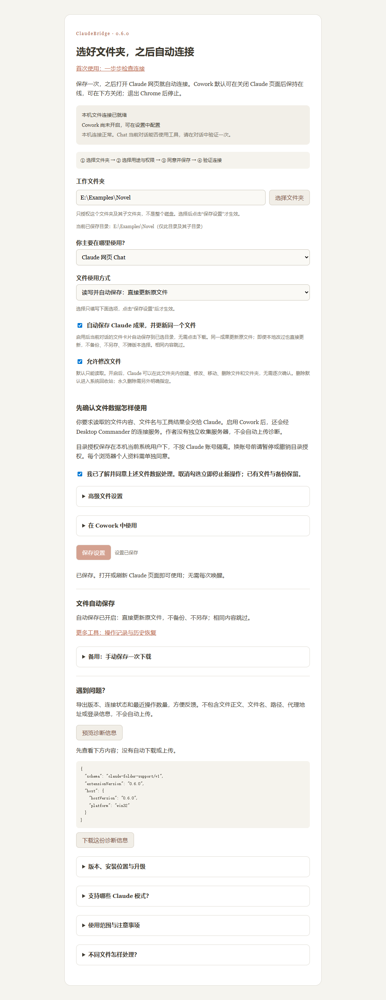
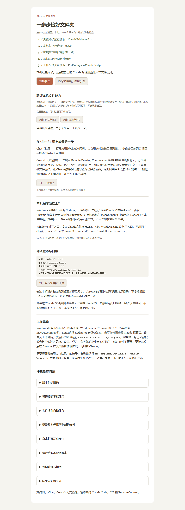

# Claude 文件连接 0.6.0：使用指南、常见问题与故障处理

> 构建标识：`0.6.0-reconnect.20261016-publish.20261017`；内部兼容版本为 `0.6.0`。

> 目前支持 Claude 网页 Chat 和可选的 Cowork 连接，尚未更新到支持 Claude Code 模式（包括网页 Code、CLI 和 Remote Control）。

适用：Windows x64、Chrome、Claude 网页 Chat，以及可选的 Cowork 连接。

## 1. 先安装，再选择文件夹

### 第一次安装

1. 解压整个Windows包，不要直接在压缩包里启动程序。
2. 双击`安装Claude文件连接.exe`，使用安装向导。它把程序放到固定安装位置；安装完成前不要删掉解压文件。
3. 打开`chrome://extensions/`，开启开发者模式，点击“加载已解压的扩展程序”，选择**安装目录**下的`extension`。不是随便选旧解压目录。当前包没有在商店上架。
4. 点扩展图标进入“文件夹与设置”，阅读文件数据说明，选择工作文件夹。
5. 只看文件时保持只读。需要新建、修改、移动、删除时勾选“允许修改文件”；需要Claude生成的文件卡片自动落盘时，再勾选“自动保存 Claude 成果，并更新同一个文件”。点击保存。
6. 打开或刷新Claude页面，在小窗查看连接状态。

首次建议用一个自己新建的测试文件夹，确认流程后再换正式工作目录。Windows包自带固定校验的Node运行时，不需要另装全局Node。

`安装-Windows.cmd`是高级的直接注册入口，不是另一种推荐安装方式。它可能把解压目录登记为实际程序位置，之后不能删或移动该目录；不要与安装向导混用。安装器未签名，包内运行时的签名不等于安装器已获得发行者签名。文件校验清单见`MANIFEST.sha256`，压缩包摘要见包外`SHA256SUMS.txt`。

## 2. Chat与Cowork不是同一条连接

| 入口       | 如何工作                                                  | 要检查什么                      |
| -------- | ----------------------------------------------------- | -------------------------- |
| Chat网页桥  | 当前Claude页面通过扩展连接本机，使用该Chat绑定的工作文件夹                    | 本机就绪、网页桥已握手，以及本页实际工具调用     |
| Cowork连接 | 工具请求经第三方Remote Desktop Commander服务转交本机，使用设备当前选择的工作文件夹 | 设备验证、设备在线、当前对话启用连接器，以及实际回执 |
| 云端文件自动保存 | 扩展识别当前对话成果卡片，取得原字节后保存到绑定目录                            | 文件卡片是否识别、保存记录是否完成    |

**设备在线不等于本页连接器已启用；云端生成成功也不等于本机已经保存。** Claude可能看不到浏览器扩展的保存回执，不能因此直接认定成功或失败。

### Cowork首次使用

在扩展设置展开“在 Cowork 中使用”，启用连接并保存。到Claude中启用Remote Desktop Commander连接器，按设置页提供的官方验证链接完成设备验证。设备显示通用名称`Claude Folder`。

多设备时确认当前在线的目标设备，不自动换到另一台电脑。曾经的测试发现旧设备编号可能失效；先重新确认在线列表，再按实际返回编号查询。新修订增加了身份保护和原记录恢复机制，不需要因普通网络波动就重新登记设备。

后台在线选项默认开启：Chrome仍运行、已同意文件处理且Cowork启用时，可以在关闭Claude标签页后维持设备连接。关闭此选项后只在有Claude页面时连接；退出Chrome会停止。是否在当前浏览器环境下持续在线，以实际状态为准。

### 网络怎么选

一般保持“自动寻找可用连接”。程序寻找现有本机HTTP、HTTPS、SOCKS代理入口，不限定某个代理软件或端口；找不到时停止，不自动转为直连。纯VPN/TUN、没有本机代理入口时，可明确选择系统网络模式并确认实际路由。

插件不修改VPN节点或系统代理，不查询公网IP，也不能证明真实IP已隐藏。Claude网页与设备验证页仍使用浏览器自己的网络。连接失败可能来自本机程序、代理入口、节点、第三方服务或登录状态；没有证据时不把原因归到某一方。

## 3. 小窗里的状态怎么理解

| 显示            | 含义                      | 下一步                                  |
| ------------- | ----------------------- | ------------------------------------ |
| 待连接、本机未连接     | 尚未建立本机通道，或通道断开          | 检查配套程序安装及扩展目录，点击重试连接；更新过扩展时重新加载并刷新页面 |
| 本机就绪          | 本机文件通道可用                | 再检查当前Chat握手或Cowork连接，不把它当作所有通路成功     |
| Chat已握手，待本页调用 | 网页桥接入，但本页尚未产生工具操作       | 发一条只读小任务确认即可，不必反复让模型搜索工具             |
| Cowork未开启     | 设置里未启用远端连接              | 需要Cowork时启用并保存；只用Chat不必开启            |
| 等待设备验证        | 还没完成设备授权                | 打开连接设置，使用其中的验证链接和验证码                 |
| Cowork在线      | 服务侧设备连接已建立              | 仍须在当前对话启用连接器；看实际操作回执                 |
| 网页状态通道断开      | 页面与扩展通路中断，旧页面或扩展更新也可能引起 | 先核对正在执行的操作，再重试连接或刷新；不要重发未知写入         |
| 文件夹不可用        | 工作目录暂时丢失、磁盘断开或路径不可访问    | 检查原目录是否回来，或在设置重新选择；程序保留配置，不因目录暂时消失退出 |
| 上一连接正在关闭、锁被占用 | 原进程或另一个资料仍持有连接锁         | 等待收尾，不重复启动很多实例，不手动抢活锁                |
| 有文件结果待处理      | 存在冲突、未知、部分完成或被阻止的成果     | 打开详情/文件工作台看具体项目，不一定是最近一次已成功的操作失败     |

小窗只反映本机收到的文件操作，不读取Claude思考过程，不统计订阅额度。桌宠庆祝表示一次本机文件操作完成，不代表整个任务结束。日常小窗显示连接状态、文件夹和最近保存结果；打开文件夹、设置、收起可以直接操作。记录与诊断放在“更多”和工作台，正常保存不需要打开工作台。四个角都可以拖动改变宽高，大小和位置会记住。

## 4. 怎样把任务交给Claude

### 精确修改

> 只在当前已授权工作文件夹操作。把“笔记.txt”里的“状态：待修改”改成“状态：已完成”，其余内容保持原样。先按需读取相关内容，使用局部编辑；根据真实回执汇报。结果未知时查询原编号，不重复执行。

多处文字修改尽量一次提交。文字编辑仍需可靠原文或校验基线，不要为了省调用跳过变化检查。Office文字修改默认更新原文件，明确指定另存路径才产生另一份。

### 生成一个文件卡片

> 在云端生成一个名为“示例成果.txt”的可下载文件卡片，内容为“演示第一版”。不要用本机write_file逐字重抄，交由文件连接插件保存。若看不到本机回执，明确说未看到，不声称已落盘。

下一轮需要同文件更新时，说明沿用同一云端成果、路径和文件名，再更新内容。仅仅文字中写“同名”不能保证平台把它认作同一个成果；插件依据实际成果标识与版本处理。

### 收集有用反馈，不增加无关测试

> 正常完成我的任务，不为收集反馈读取无关文件。结束后只依据实际调用，列出遇到的问题、参数与返回证据、额外调用的影响和改进建议。区分插件、本机连接、第三方服务及操作方法；原因不明写原因未确定，没用过的能力写未验证，不估算token节省比例。

文件工具不提供本机shell或Python执行能力。Cowork若显示`remoteCommandsEnabled=false`，不要让Claude假定能执行命令，也不要切换到其他设备绕过。

## 5. 自动保存：直接更新原文件

开启“自动保存 Claude 成果”后，正常识别到的成果卡片无需点击下载即可保存原字节，不让模型再抄一遍文件。

- 首次保存：直接写入目标位置。
- 内容相同：跳过，不重复写入。
- 内容不同：直接更新原文件，即使你在其他软件改过也一样；不备份、不另存、不弹版本选择。
- 本地文件已删除：下次接收该成果时重新保存。
- 已保存过的较早成果卡片：不会自动回退当前新版本。

程序保留目录权限、参考文件保护、传输完整性校验和提交前状态检查。文件占用、权限不足或结果未知时会明确提示，不通过重放未知操作来“修复”。原有历史恢复记录及升级前待处理记录保留，不会自动删除或擅自执行；正常自动保存不再制造版本选择任务。

Chat对话有自己的目录绑定；Cowork文件工具使用当前设备目录，两者可能不同。仅切换当前工作文件夹，不代表已有Chat成果自动改绑。需要更改时明确重新绑定；查看小窗的成果绑定目录和设备目录。

“保留Claude输出目录结构”默认关闭；开启后对新成果保留outputs里的相对子目录，旧成果仍更新原关联路径。Windows非法文件名会转换，危险可执行后缀会追加`.txt`，不更改文件内容字节。

### 找不到刚生成的文件时

先在文件工作台看是否有识别、暂存、冲突、失败或保存回执，再核对该对话绑定目录。模型没看到本机回执、当前目录里没找到文件，都不足以单独证明未保存；可能保存到原绑定目录，也可能仍待处理。

模型需要确认时，可按实际工具能力查询`get_saved_file_status`，Cowork按`get_config`的兼容说明查询。历史回执的`currentContentRechecked=false`表示本次没有再次读取当前文件全文，不能把历史SHA当成外部编辑后的当前SHA。

### 备用下载保存

只有自动保存不识别或明确需要接收原下载时，才使用工作台的备用保存：先开启本次接收，再点Claude原下载按钮。它不会扫描历史下载，原下载保留，同名另存。这与零点击自动保存是两种机制，不要误以为每次自动保存都要先点“开启本次批量保存”。

批量备用接收最多100个文件，30分钟或10分钟无新下载后停止接收。原下载的短期抑制最多两分钟且只拦截一次；发生拦截会提示，之后仍能正常手动下载。

## 6. 常见问题与处理办法

| 现象                                        | 已知事实或可能原因                            | 正确处理                                                |
| ----------------------------------------- | ------------------------------------ | --------------------------------------------------- |
| 设备离线，get_config说没有在线设备                    | 测试中实际发生过；单凭报错不知道是应用未运行、网络还是会话问题      | 看设置/小窗的具体连接原因，重试连接；确认原目标设备在线后再开始任务                  |
| list_directory或move_file只给running和call_id | 异步任务已进入处理，不是文件操作成功证据                 | 保留原call_id，按工具说明查询原结果，不重新发起目录写入或改名                  |
| 查询只给completed，没有路径或正文                     | 第三方可能只交付状态；不能凭这个状态确认文件级结果            | 用get_config兼容status说明查询本机原回执；仍无结果时到工作台或针对性查目录       |
| get_tool_result报参数类型无效                    | 第一轮曾发生，具体原因未确定                       | 先查当前schema和调用编号格式，不猜参数、不无限查询；保留未确认结果                |
| edit_block的schema是空对象                     | 托管工具目录曾省略参数表，不代表本机编辑不可用              | 一次get_config取得参数帮助/兼容协议；不要凭描述反复试错。新版未宣称修改第三方目录      |
| 旧设备ID报离线，新同名设备有另一ID                       | 测试中曾出现；旧缓存编号不可直接复用                   | 核对当前在线目标。新版尽量保护原身份；普通断网不要直接选“作为新设备登记”               |
| 工具集断开又恢复，模型多次ToolSearch                   | 实际遇到过，原因未完全确定                        | 不为每次状态变化重复加载全部工具；恢复后确认必要工具，结果未知先追原编号                |
| 搜索先返回数量，没返回命中行                            | 旧托管流程可能分两次；小结果新版执行器支持内联，但实际目录链路不保证一致 | 返回sessionId时按实际帮助取下一页，别因没正文重复搜索                     |
| 编号长度不合法，提示未执行                             | 本机稳定编号要求8至100个字母、数字、横线或下划线           | 换合法编号/参数再提交；明确前置拒绝可纠正，不与未知状态混淆                      |
| 模型指定的operation_id与回执不同                    | 托管服务可能不转发该字段；真实测试曾出现                 | 普通调用以实际operationId为准；需稳定编号时使用get_config给出的保留batch协议 |
| 工具改名已完成，小窗仍“需注意”                          | 可能另有成果冲突/未知项；状态要按项目区分                | 展开待处理项，先核对哪件事有问题，不重复已经完成的改名                         |
| 云端新版本生成成功，但模型没有本机保存回执          | 模型只能看到云端回执；请以本机保存回执确认同文件更新            | 看插件保存回执和目标目录；不要求模型重抄成品，也不让它编造落盘证明                   |
| 保存设置后刷新，显示状态通道断开                          | 实际出现过；旧后台、页面桥或连接中断都可能造成              | 先保存草稿、核对未完成操作，重试连接；扩展更新后重新加载并刷新页面                   |
| 本机就绪但“等待设备验证”                             | 本机和Cowork授权是两回事                      | 在设置完成设备验证，并在当前Cowork对话启用连接器                         |
| 更新脚本首行报“param不是命令”                        | 曾遇到UTF-8 BOM/旧脚本兼容问题；新版检查禁止相关BOM进入发布 | 确认运行的是完整0.6.0包，不单独混用旧脚本；保留报错与版本反馈，不修改登录数据来解决脚本问题    |
| 安装向导拒绝换目录安装                               | 已存在另一个通用版安装                          | 使用更新入口，不重复注册不同解压目录                                  |

## 7. 结果不明时，别把“重试连接”当成“重做文件”

| 操作状态                               | 怎样继续                              |
| ---------------------------------- | --------------------------------- |
| 明确未执行/rejected，并有retryAllowed:true | 纠正所指出的参数或条件，再提交；可按协议沿用编号          |
| running/processing                 | 查询原编号，等待或查看工作台，不重复操作              |
| completed并有完整回执                    | 按回执查看路径、大小、SHA、替换数等；无需只为证明保存再全文读回 |
| completed但没正文                      | 先恢复原回执，不自行把传输状态升级为文件级验证           |
| partial                            | 保留已完成部分，核对每项，仅处理确认未完成的部分，不整批重做    |
| unknown/interrupted                | 可能已经修改过文件；核对原编号、工作台和目标状态后再决定      |
| not_found                          | 可能没到达，也可能过期、清理或编号不匹配；不是自动重做许可     |

本机会记录已经确认的写入回执；只读快照最多在原进程内保留10分钟，重启或过期后可能查不到。状态查询本身异步时最多两层原结果恢复；仍无正文就改看工作台，不无限get_tool_result套查询。

网络恢复时只重传同一个结果，不自动再改文件。工作台“核对”是查询，界面“清空显示”只清显示，不删除文件、备份或防重复记录。

## 8. 其他可能出现的问题

| 情况                 | 表现与处理                                                      |
| ------------------ | ---------------------------------------------------------- |
| 新文件卡片结构不被识别        | 稳定疑似卡片会提示可能未识别，流式生成中不提前报错。先保留云端原成果，查看提示；确有需要用备用下载，不伪称已自动保存 |
| 网络入口变化/代理失效        | 查看当前本机代理和来源，必要时明确固定现有入口。程序有退避，不会悄悄直连；不要把反复重新设备授权当网络修复      |
| 验证码过期或被拒           | 在设置明确重新获取验证码，不反复点击新设备登记                                    |
| 登录记录损坏或解密失败        | 保留原记录，设置提供原设备重新验证或双确认新登记；新登记可能产生另一设备，不能当普通重连使用             |
| 自动保存目标被修改或同名 | 直接更新原文件，不备份、不另存、不弹版本选择；占用或权限导致失败时显示原因 |
| 工作目录不存在、移动盘断开      | 设置仍可打开，检查目录或重新选择；不因临时不可用清空授权                               |
| 宽目录或敏感路径拒绝         | 主目录等宽授权需额外确认；程序、登录、启动项、链接及私有状态仍受保护，不因选了父目录而开放              |
| 设置只保存了一部分          | 界面会区分本机设置与扩展偏好，未确认时停止新操作；核对草稿后重新完整保存，不把部分结果当全部完成           |
| 扩展与本机版本不一致         | 新操作会拒绝；确认加载的是配套安装目录，重新加载扩展并刷新页面                            |
| 大文件、慢盘或处理超时        | 停止并返回超时/未知等实际状态。先查原结果及源、目标，不把超时当成从未执行                      |
| 回收站不可用或非固定卷        | U盘、网络盘等会拒绝默认回收，不改成永久删除；固定卷结果未知先核对原处与回收站                    |
| 恢复副本接近上限           | 80%有提示；符合条件的旧副本可自动归档，空间不足时拒绝需要备份的改写。归档不释放磁盘空间              |
| 恢复副本损坏或当前文件已变      | 拒绝恢复，不强行覆盖。到工作台选择有效版本或先保留当前内容                              |

这些情况不等于每位用户都会遇到。U盘FAT/exFAT、特殊回收站策略、短文件名、长时间慢盘传输和第三方界面变化，当前修订没有全部实机验收。

## 9. 文件格式与处理边界

| 类型                      | 可做什么               | 边界                                   |
| ----------------------- | ------------------ | ------------------------------------ |
| UTF-8文字、代码、CSV          | 片段读取、搜索、精确替换、新建、追加 | 预览最多1 GiB；局部编辑64 MiB；每次新文字4 MiB      |
| GBK/GB18030、带BOM的UTF-16 | 受支持文本扩展的只读预览、搜索    | 不转换原文件，不直接编辑；大文件旧编码预览不承诺与UTF-8流式一样   |
| DOCX/PPTX               | 读取文字部分、精确改字、明确另存   | 容器256 MiB、展开总量512 MiB；不编辑图片、图表、主题或布局 |
| XLSX                    | 读工作表、单元格及已有公式缓存    | 不重新计算或编辑公式，不编辑图表                     |
| PNG/JPEG                | 有界预览及局部查看、原字节保存    | 源64 MiB、4000万像素；预览可能缩放，不能替代原图        |
| PDF、旧Office、其他二进制       | 查询信息、复制、移动、保存原字节   | 不以文本工具改写内容，不是完整PDF/旧Office编辑器        |

普通复制、移动和备用下载主要受处理预算与磁盘空间约束。Chat普通文件操作预算10分钟；Cowork本机单次预算4分钟，锁等待包含在预算内；第三方可能更早超时。自动成果接收总体上限4 GiB、20分钟，但Cowork预览接口的base64成果通路有64 MiB单文件限制，不能把4 GiB当作所有通路都支持。

Windows同盘移动优先无覆盖改名，跨盘才复制校验再移除源；复制保留修改时间，不保证ACL、创建时间和备用数据流等所有属性完整保留。

## 10. 恢复、暂停与隐私

自动保存成果不备份旧版。通过本机文件工具编辑和替换既有文件，仍保留该工具原有的恢复副本；新建文件没有旧版本。可在工作台查看副本并按编号恢复，恢复会核对文件当前状态。批量任务不保证跨文件整体回滚，先检查每项结果。

活跃副本上限4 GiB或2000份，满足条件的较旧版本可归档，并尽量保留每文件最近五份。归档上限取16 GiB与当时剩余空间10%的较小值。归档保留期默认关闭；明确开启后只尝试将到期归档移入系统回收站，未知结果不自动重试。程序不自动清空回收站。

点“暂停”停止新文件操作，已开始的单项完成收尾，批量不再开始下一项。它不停止Claude思考或云端任务。恢复连接或取消暂停不会自动补做旧任务。

恢复副本和冲突暂存默认明文保存在本机私有目录，不要随程序发给别人。Windows登录使用当前用户DPAPI保护；卸载默认保留工作文件、设置和恢复副本。工作台分项清理私有数据是另外的明确永久删除操作，清操作记录后会暂停新操作；清本机登录不等于撤销服务端设备授权。

读取的文件内容、名称及工具结果会交给Claude；Cowork还经过第三方服务。只在自己选择的文件夹工作，不提供本机命令执行。目录授权按本机用户保存，不按Claude账号隔离，切换账号前可暂停或撤销授权。

## 11. 反馈问题时提供什么

提供程序版本、Chrome版本、Chat还是Cowork、具体动作、界面实际提示、原操作编号，以及结果是未执行/未知/部分完成/完整成功。必要时导出诊断再自己检查后发送，不附登录令牌、验证码或正式文件正文。

一句话范例：

> 0.6.0，Cowork，移动一个虚构TXT。首次running，查询completed但没正文，工作台显示已保存并校验；没有重复执行。请看原编号和截图判断是回执交付还是实际文件操作问题。

不要只说“在线但不能用”或“没有文件就是没保存”。把本机连接、当前页面工具、云端卡片和本机文件四个环节分开，便于区分文件操作与回执交付问题。

## 中英文界面

双击 `安装Claude文件连接.exe`，在向导上方的 **Language / 语言** 中选择中文或 English，再安装。首次打开扩展设置时默认使用安装选择；之后可在设置页、弹窗、工作台或首次使用页上方切换。切换会重新加载该页，先保存未保存的设置。网页小窗会跟随语言偏好更新。

语言切换只改变程序界面，不翻译文件名、路径、文件正文、操作编号或 Claude 的回复，也不改变目录授权和登录。扩展更新后请重新加载扩展并刷新 Claude 页面。更新与切回入口也支持选择语言。

## 本机已写入成果与重复提示

若 Claude 已通过本机工具把文件写入工作文件夹，浏览器又收到同一成果文件卡片，插件会优先核对近期成功的本机写入回执。仅当文件名、当前文件字节数与 SHA256 均匹配，且候选路径唯一时，关联这个已存在的文件；不在根目录重复创建，不再次备份。相同路径内容已经一致时，同样不重复写入。查找仅依据当前授权目录的近期操作回执，不遍历工作文件夹搜寻正文；超出候选数量或核对容量范围时保留正常保存流程，不猜测目录。多个候选或缺少可信记录时不猜子目录，使用已有绑定或默认目标。目标内容不同时直接更新，不备份。升级前明确选择忽略的成果版本不重放。

操作记录与实际文件数量不同。工作台按完整路径展示最新完成记录，历史记录折叠保留；待选择、未知和部分完成记录仍独立显示。完成记录的“查看恢复选项（可选）”不是继续处理步骤。核对得到原操作已经完成后，小窗同步更新该条状态；未返回的记录和其他目录的提醒不会被一并清除。

“显示所在位置”在 Windows 下请求资源管理器选中文件，打开文件夹时不隐藏窗口。界面只说明打开请求已发出，不把进程启动当成窗口已显示的证明；若没有窗口，手动打开授权目录核对即可，不必重写文件。

从本机近期回执识别到其他子目录的相同文件后，只建立已存在内容的关联；后续云端新版本若没有对应本机写入证据，不因此自动覆盖该子目录文件，仍需明确核对。

## 常用页面示例

以下截图来自独立本地测试页面，目录和记录均为虚构示例，不是用户账号或正式文件。按钮与本包界面对应。

